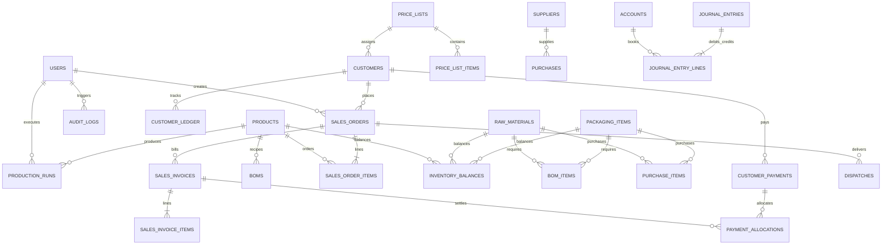

# FACTORYFLOW Database Schema & Entity Relationships

This document details the relational architecture, schema constraints, indexes, and primary key models of FACTORYFLOW.

---

## 1. Entity-Relationship Overview

---

## 2. Table Specifications

### A. Core Master Data Tables
- `users`: User identity, hashed passwords (`bcrypt`), and system roles (`OWNER`, `ADMIN`, `SALESMAN`, `PRODUCTION`, `AUDITOR`).
- `customers`: Retailers and distributors with GSTIN format validation, state codes, assigned tiered price lists, and credit limit in paise.
- `suppliers`: Material vendors with GSTIN, address, and credit terms.
- `products`: Finished goods SKUs (e.g. Murukku 200g), pack size, pack unit, HSN codes, GST rate (5%), and default selling price in paise.
- `raw_materials`: Grains, flours, oils, and spices with base measurement units (`kg`, `litre`).
- `packaging_items`: Printed pouches, corrugated shipping cartons, labels, and tapes.
- `price_lists` & `price_list_items`: Tiered pricing for distributors and retailers with customer-level price overrides.

### B. Inventory & Purchase Tables
- `purchases` & `purchase_items`: Inward purchasing, supplier invoices, GRN vouchers, tax breakdown (CGST/SGST/IGST), and posting status.
- `stock_movements`: Single source of truth immutable ledger tracking all stock ins and outs.
  - Fields: `id`, `item_type` (`RAW`, `PACKAGING`, `FG`), `item_id`, `movement_type`, `qty_delta`, `unit_cost_paise`, `total_cost_paise`, `source_type`, `reference_number`, `created_at`.
- `inventory_balances`: Materialized stock snapshot cache for rapid query indexing.

### C. BOM & Manufacturing Tables
- `boms` & `bom_items`: Standard recipe specifications with target batch yield packets and tolerance percentage.
- `production_runs`: Executed factory floor batches with planned vs actual output, damaged packaging, wastage, overhead expenses, and yield variance status (`NORMAL`, `WARNING`, `CRITICAL`).
- `production_run_materials`: Actual material issue records with unit costs and quantity variances.
- `production_overheads`: Direct labour and factory gas/power overhead expenses.

### D. Sales, Dispatch & Commercial Tables
- `sales_orders` & `sales_order_items`: Customer orders with approval status (`DRAFT`, `SUBMITTED`, `APPROVED`, `PARTIALLY_FULFILLED`, `FULFILLED`, `CANCELLED`).
- `sales_invoices` & `sales_invoice_items`: Commercial GST invoices, intra-state (CGST/SGST) vs inter-state (IGST) resolution, and paid amount tracking.
- `dispatches` & `dispatch_items`: Delivery challans, vehicle numbers, transporter names, driver phones, and stock reduction triggers.

### E. Financial, Payment & Audit Tables
- `customer_payments` & `payment_allocations`: Bank transfer (NEFT/RTGS), cheque, and cash payments allocated against posted invoices.
- `customer_ledger_entries`: Running financial balance per customer for real-time debtor statements.
- `accounts`: Chart of Accounts categorized into Assets, Liabilities, Equity, Revenue, and Expenses.
- `journal_entries` & `journal_entry_lines`: Double-entry accounting vouchers with balanced debit and credit invariants.
- `audit_logs`: Immutable, append-only security and operational audit trail with user ID, action, entity type, entity ID, details, and timestamps.
